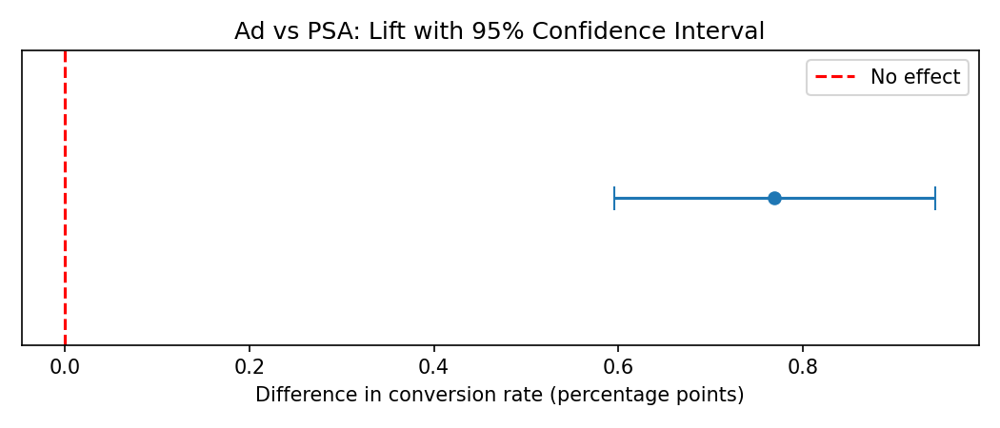
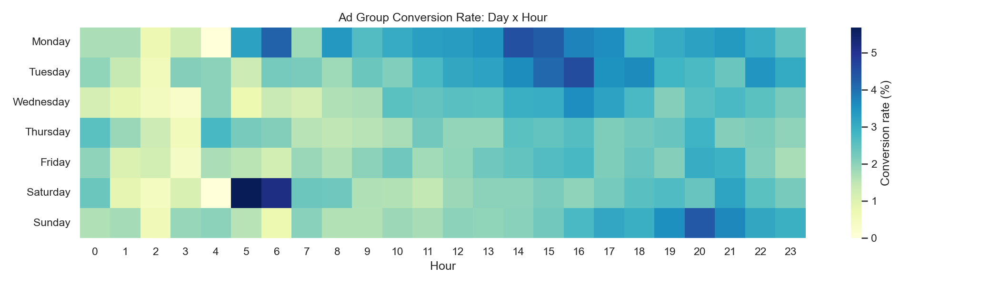

# Marketing A/B Test Analysis: Did the Ad Actually Work?

> **TL;DR:** An A/B test of **588,101 users** showed the ad group converted at **2.555%** vs **1.785%** for the PSA control, a **43.09% relative lift** (p = 8.5 × 10⁻¹⁴, 95% CI for the difference: 0.595 to 0.943 percentage points). The ad clearly works at driving conversions. Whether it pays off depends on real revenue and cost: under illustrative assumptions ($50 per conversion, $0.50 per user) ROI is negative, so the next step is to validate the economics and test scheduling and frequency caps.

**Power BI Dashboard:** [View Dashboard (.pbix)](dashboard/Marketing_AB_Test_Dashboard.pbix) | [Dashboard Preview (PDF)](dashboard/Marketing_AB_Test_Dashboard.pdf)

**Tools:** Python (pandas, statsmodels, scipy, seaborn), Power BI, Jupyter

---

## 1. Business problem

A marketing team ran an ad campaign and wants to know:

1. Did the ad increase conversion compared with a neutral public service announcement (PSA)?
2. Is the difference statistically significant, or just noise?
3. How large is the lift, and is it worth the cost?
4. When and how often should the ad be shown?

## 2. Dataset

[Marketing A/B Testing dataset (Kaggle, faviovaz)](https://www.kaggle.com/datasets/faviovaz/marketing-ab-testing): **588,101 users**.

| Column | Meaning |
|---|---|
| `test_group` | `ad` (saw the advertisement) or `psa` (control) |
| `converted` | Whether the user purchased |
| `total_ads` | Number of ads the user saw |
| `most_ads_day` / `most_ads_hour` | Day and hour when the user saw the most ads |

## 3. Approach

1. **Cleaning and checks:** nulls, duplicates, types, outliers in `total_ads`.
2. **EDA:** conversion by group, day, hour and ad exposure.
3. **Hypothesis testing:** one-sided two-proportion z-test (H0: equal rates, H1: ad > PSA), cross-checked with a chi-square test.
4. **Effect size:** absolute lift, relative lift and 95% confidence interval for the difference.
5. **Power analysis:** achieved power and minimum detectable effect.
6. **Segment analysis:** lift by day, hour and exposure bucket, with a Bonferroni correction because many tests were run.
7. **Logistic regression:** checked the ad effect after controlling for exposure, day and hour.
8. **Business impact:** converted lift into extra conversions, revenue and ROI (assumptions stated below).
9. **Dashboard:** built an interactive Power BI dashboard and exported a PDF preview of the dashboard.

## 4. Key results

| Metric | Ad | PSA |
|---|---:|---:|
| Users | 564,577 | 23,524 |
| Conversion rate | 2.555% | 1.785% |

| Test result | Value |
|---|---:|
| Absolute lift | 0.769 percentage points |
| Relative lift | 43.09% |
| 95% CI for the difference | 0.595 to 0.943 percentage points |
| z-statistic / p-value | 7.370 / 8.526 × 10⁻¹⁴ |
| Achieved power | 1.000 |
| Adjusted odds ratio (logistic regression) | 1.4808 (95% CI 1.3377 to 1.6393) |

**Plain-English conclusion:** The ad group converted at 2.555% compared with 1.785% for the PSA group, a 43.09% relative lift. The confidence interval excludes zero and the effect holds after controlling for exposure, day and hour (adjusted odds ratio 1.48), so the difference is very unlikely to be random noise.



## 5. Segment insights

These are observed differences. Individual segments were tested with a Bonferroni correction, but treat them as exploratory until confirmed in a follow-up test.

- **Largest observed lift by day:** Tuesday (+1.599 percentage points).
- **Largest observed lift by hour:** 14:00 (+1.252 percentage points).
- **Ad frequency:** conversion rises with exposure, but the analysis does not establish a reliable flattening point. Do not claim a specific frequency cap from these results.



## 6. Recommendations

1. **Validate the campaign economics with real revenue and cost data.** Under the illustrative assumptions below, the campaign loses money, and it would break even at roughly $65 revenue per conversion. Real figures decide whether to scale it.
2. **Test scheduling in a follow-up experiment** around Tuesday and 14:00, where the observed lift was largest.
3. **Test frequency caps experimentally** before choosing a cap.

**Business impact (assumptions):** revenue per conversion = $50, cost per targeted user = $0.50. Estimated extra conversions: 4,343; incremental revenue: $217,149; estimated ROI: −23.1%. These are illustrative assumptions, not company data.

## 7. Power BI Dashboard

The interactive Power BI dashboard summarizes conversion performance, key KPIs, and trends by test group, day, hour, and ad exposure.

**Dashboard files:**
- `Marketing_AB_Test_Dashboard.pbix` — interactive Power BI dashboard.
- `Marketing_AB_Test_Dashboard.pdf` — PDF preview exported from Power BI.

Open the `.pbix` file in Power BI Desktop to explore the dashboard interactively.

## 8. Limitations

- **Imbalanced groups:** only 4.00% of users are in the PSA control, so the control estimate is less precise (the z-test is still valid).
- **Exposure is not randomized:** `total_ads` is measured after assignment, so the exposure curve shows correlation, not causation.
- **No cost data:** ROI depends on assumed values.
- **Possible novelty effects**, and no information on repeat purchases or customer lifetime value.
- **Multiple comparisons:** segment findings were corrected with Bonferroni, but remain exploratory.

## 9. Project structure

```text
marketing-ab-testing/
├── data/
│   └── marketing_AB_clean.csv
├── notebooks/
│   ├── cleaning_eda.ipynb
│   ├── hypothesis_testing.ipynb
│   ├── segment_analysis.ipynb
│   └── dashboard_prep.ipynb
├── outputs/
│   ├── lift_confidence_interval.png
│   ├── heatmap_day_hour.png
│   └── dashboard_data/
├── dashboard/
│   ├── Marketing_AB_Test_Dashboard.pbix
│   └── Marketing_AB_Test_Dashboard.pdf
└── README.md
```

## 10. How to run

```bash
pip install pandas numpy matplotlib seaborn scipy statsmodels
# Download marketing_AB.csv from Kaggle into data/
# Run the notebooks in sequence: cleaning/EDA, hypothesis testing, segment analysis, dashboard prep
# Open the .pbix file in Power BI Desktop or view the dashboard PDF preview
```

## 11. About me

**Ravsaheb Bansode** | [LinkedIn](https://www.linkedin.com/in/ravsaheb-bansode/) | [Portfolio](https://ravsaheb-bansode-portfolio.vercel.app/) | bansoderav@gmail.com